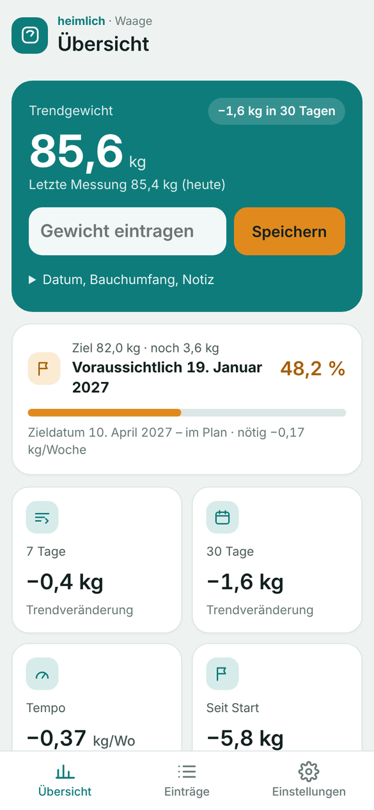
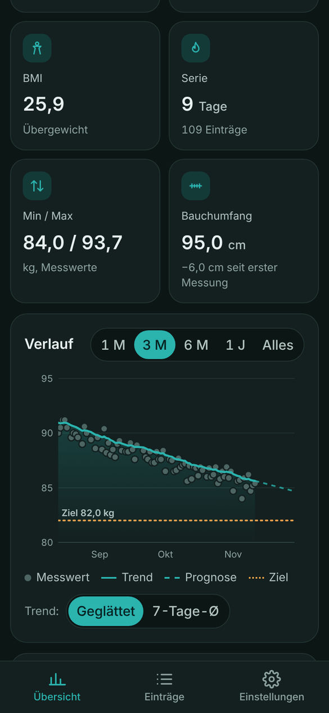

# heimlich · Waage

*Teil der **heimlich**-Reihe: kleine Tools, die zu Hause laufen und deine Daten bei dir lassen.*

Selbst gehosteter Gewichtstracker fürs Heimnetz. Zeigt statt schwankender Tageswerte das
**Trendgewicht**, berechnet Tempo und Prognose zum Zielgewicht und lässt sich bequem vom Handy
bedienen. Web-App mit FastAPI und schlankem Browser-Frontend ohne externe Abhängigkeiten,
Daten in einer SQLite-Datei, Betrieb per Docker (Laptop oder NAS).

> [!WARNING]
> **Im Standardmodus (`AUTH_MODE=none`) nur für den lokalen Betrieb im eigenen Netz gedacht.**
> In diesem Modus hat die App keine Anmeldung,
> kein HTTPS und keinen Schutz gegen Missbrauch (z. B. Rate-Limits). Jeder, der den Port erreicht,
> kann alle Daten lesen, ändern und löschen. Die App daher **nicht** per Portfreigabe, Reverse
> Proxy oder Tunnel ins Internet stellen. Für Zugriff von unterwegs besser ein VPN ins Heimnetz
> nutzen (z. B. WireGuard oder Tailscale). Mit Anmeldung und getrennten Daten pro Person:
> siehe [Betrieb hinter Authelia](#betrieb-hinter-authelia-auth_modeproxy).

## So sieht es aus

<table>
  <tr>
    <td align="center"></td>
    <td align="center"></td>
    <td align="center"></td>
  </tr>
  <tr>
    <td align="center"><sub>Übersicht</sub></td>
    <td align="center"><sub>Verlauf (Dunkelmodus)</sub></td>
    <td align="center"><sub>Einträge</sub></td>
  </tr>
</table>

<sub>Screenshots mit Beispieldaten.</sub>

## Starten

Voraussetzung: Docker mit Compose-Plugin, dein Benutzer in der Gruppe `docker`.

```bash
./waage.sh            # bauen, starten und Adresse anzeigen
```

Beim ersten Start legt das Skript die `.env` und den Datenordner `~/gewicht-daten` an.
Danach zeigt es die Adressen für Laptop und Handy (im selben WLAN) an.

| Befehl | Wirkung |
|---|---|
| `./waage.sh start` | bauen und starten (Standard) |
| `./waage.sh stop` | anhalten, Daten bleiben erhalten |
| `./waage.sh restart` | neu starten |
| `./waage.sh status` | läuft sie, ist sie erreichbar? |
| `./waage.sh logs` | Protokoll live ansehen |
| `./waage.sh update` | neuesten Stand von GitHub holen und neu starten |
| `./waage.sh backup` | Kopie der Datenbank nach `~/gewicht-daten/backups/` |

Die Datenbank liegt im Ordner `DATA_PATH` aus der `.env` und wird im Container unter `/data`
eingebunden. Sie wird **nie** ins Git-Repo eingecheckt. Ohne Skript geht es auch direkt:
`docker compose up -d --build` bzw. `docker compose down`.

## Funktionen (MVP)

- Gewicht, optional Bauchumfang und Notiz eintragen – ein Wert pro Tag; Bearbeiten und Löschen in der Liste
- Trendgewicht (exponentiell geglättet oder 7-Tage-Durchschnitt), Diagramm mit Zeitraumwahl
- Kennzahlen: 7/30 Tage, Tempo kg/Woche, seit Start, BMI, Serie, Min/Max
- Zielgewicht mit optionalem Zieldatum, Fortschritt und Prognose
- CSV-Export und -Import (Einstellungen → Daten)
- Mobil bedienbar, Navigation mit Übersicht, Einträgen und Einstellungen
- Hell- und Dunkelmodus (automatisch oder fest), Schrift Inter mit gleich breiten Ziffern

## Tests

Ohne lokale Python-Installation, in einem Wegwerf-Container:

```bash
docker run --rm -v "$PWD":/src:ro -w /src -e PYTHONDONTWRITEBYTECODE=1 python:3.12-slim \
  sh -c "pip install -q --root-user-action=ignore -r requirements-dev.txt && pytest -q -p no:cacheprovider"
```

## Entwickeln ohne Docker

```bash
python3 -m venv .venv && . .venv/bin/activate
pip install -r requirements-dev.txt
pytest -q
cd backend && DATA_DIR=~/gewicht-daten uvicorn app.main:app --reload
```

## Aufbau

```
backend/app/
  analytics/   Trend, Prognose, Kennzahlen (reines Python)
  api/         REST-Endpunkte (/api/...)
  core/        Konfiguration, Datentypen, Nutzer-Ermittlung (auth.py)
  importers/   CSV (später Waagen-Importe)
  storage/     SQLite, Migrationen, Repository
frontend/      index.html, app.js, chart.js, style.css – ohne Build-Schritt
deploy/nas/    Vorlage für den Betrieb hinter Traefik + Authelia
docker/        Entrypoint des Containers
tests/
```

## Betrieb hinter Authelia (`AUTH_MODE=proxy`)

Für den Betrieb auf einem Server hinter einem Anmelde-Proxy wie **Traefik + Authelia**. Die App
verwaltet dann keine Passwörter selbst. Sie liest den angemeldeten Nutzer aus den Headern, die der
Proxy nach erfolgreicher Anmeldung setzt. Jede Person hat ihre eigenen, getrennten Daten.

> [!CAUTION]
> Im Proxy-Modus vertraut die App den Headern `Remote-User`, `Remote-Name` und `Remote-Groups`.
> Das ist nur sicher, wenn **ausschließlich der Proxy** die App erreicht. **Den Port nie im Netzwerk
> freigeben** (nur `127.0.0.1` oder ein internes Docker-Netzwerk). Der Proxy muss vom Client
> mitgeschickte gleichnamige Header überschreiben (Traefik mit Authelia-Forward-Auth tut das).

**Ablauf**

1. Das Image baut GitHub Actions bei jedem Push auf `main` und legt es unter
   `ghcr.io/<owner>/heimlich-waage` ab (Tags `latest`, Kurz-SHA, Versions-Tags `v*`).
   Damit ein Server ohne Anmeldung ziehen kann, das Paket einmalig öffentlich stellen:
   GitHub → Profil → *Packages* → `heimlich-waage` → *Package settings* → *Change visibility*.
2. Auf dem Server [`deploy/nas/docker-compose.yml`](deploy/nas/docker-compose.yml) und
   [`deploy/nas/.env.example`](deploy/nas/.env.example) in einen Ordner kopieren,
   `.env.example` in `.env` umbenennen und anpassen (Domain, Abmelde-Adresse, Gruppen).
3. Bestehende Daten übernehmen (optional): die `gewicht.db` aus dem lokalen Betrieb vor dem
   ersten Start nach `data/` kopieren und `AUTH_ADOPT_DEFAULT_USER` auf den eigenen Login-Namen
   setzen. Beim ersten Anmelden gehören die bisherigen Einträge dann diesem Login.
4. `docker compose up -d`

Den Datenordner als lokalen Ordner anlegen, nicht über SMB/NFS: SQLite-Sperren sind dort
unzuverlässig.

**Einstellungen**

| Variable | Standard | Bedeutung |
|---|---|---|
| `AUTH_MODE` | `none` | `none` = ohne Anmeldung, `proxy` = Nutzer aus Headern |
| `AUTH_USER_HEADER` | `Remote-User` | Header mit dem Login-Namen |
| `AUTH_NAME_HEADER` | `Remote-Name` | Header mit dem Anzeigenamen (nur beim ersten Login übernommen) |
| `AUTH_GROUPS_HEADER` | `Remote-Groups` | Header mit den Gruppen, kommagetrennt |
| `AUTH_ADMIN_GROUP` | `admins` | Mitglieder bekommen die Rolle `admin` |
| `AUTH_REQUIRED_GROUP` | *(leer)* | wenn gesetzt: ohne diese Gruppe kein Zugriff (403) |
| `AUTH_ADOPT_DEFAULT_USER` | *(leer)* | Login, der beim ersten Anmelden die Daten aus dem lokalen Betrieb übernimmt |
| `AUTH_LOGOUT_URL` | *(leer)* | Ziel des Links „Abmelden“; leer = kein Link |
| `AUTH_TRUSTED_PROXIES` | *(leer)* | optional: nur Anfragen von diesen IPs/Netzen annehmen |

## Lizenz

Code: MIT, siehe [LICENSE](LICENSE). Mitgelieferte Schrift Inter: SIL Open Font License,
siehe [frontend/fonts/LICENSE-Inter.txt](frontend/fonts/LICENSE-Inter.txt).
