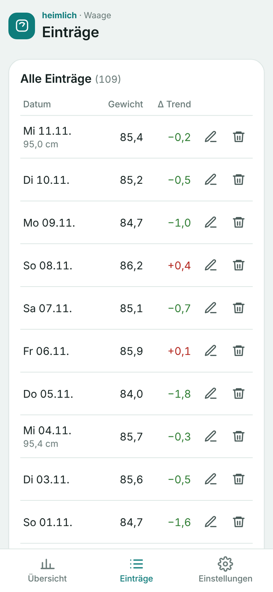

# heimlich · Waage

*Teil der **heimlich**-Reihe: kleine Tools, die zu Hause laufen und deine Daten bei dir lassen.*

Selbst gehosteter Gewichtstracker fürs Heimnetz. Zeigt statt schwankender Tageswerte das
**Trendgewicht**, berechnet Tempo und Prognose zum Zielgewicht und lässt sich bequem vom Handy
bedienen. Web-App mit FastAPI und schlankem Browser-Frontend ohne externe Abhängigkeiten,
Daten in einer SQLite-Datei, Betrieb per Docker (Laptop oder NAS).

> [!WARNING]
> **Nur für den lokalen Betrieb im eigenen Netz gedacht.** Die App hat derzeit keine Anmeldung,
> kein HTTPS und keinen Schutz gegen Missbrauch (z. B. Rate-Limits). Jeder, der den Port erreicht,
> kann alle Daten lesen, ändern und löschen. Die App daher **nicht** per Portfreigabe, Reverse
> Proxy oder Tunnel ins Internet stellen. Für Zugriff von unterwegs besser ein VPN ins Heimnetz
> nutzen (z. B. WireGuard oder Tailscale).

## So sieht es aus

<table>
  <tr>
    <td align="center"></td>
    <td align="center"></td>
    <td align="center"></td>
  </tr>
  <tr>
    <td align="center"><sub>Übersicht</sub></td>
    <td align="center"><sub>Verlauf (Dunkelmodus)</sub></td>
    <td align="center"><sub>Einträge</sub></td>
  </tr>
</table>

<sub>Screenshots mit Beispieldaten.</sub>

## Starten

Voraussetzung: Docker mit Compose-Plugin, dein Benutzer in der Gruppe `docker`.

```bash
./waage.sh            # bauen, starten und Adresse anzeigen
```

Beim ersten Start legt das Skript die `.env` und den Datenordner `~/gewicht-daten` an.
Danach zeigt es die Adressen für Laptop und Handy (im selben WLAN) an.

| Befehl | Wirkung |
|---|---|
| `./waage.sh start` | bauen und starten (Standard) |
| `./waage.sh stop` | anhalten, Daten bleiben erhalten |
| `./waage.sh restart` | neu starten |
| `./waage.sh status` | läuft sie, ist sie erreichbar? |
| `./waage.sh logs` | Protokoll live ansehen |
| `./waage.sh update` | neuesten Stand von GitHub holen und neu starten |
| `./waage.sh backup` | Kopie der Datenbank nach `~/gewicht-daten/backups/` |

Die Datenbank liegt im Ordner `DATA_PATH` aus der `.env` und wird im Container unter `/data`
eingebunden. Sie wird **nie** ins Git-Repo eingecheckt. Ohne Skript geht es auch direkt:
`docker compose up -d --build` bzw. `docker compose down`.

## Funktionen (MVP)

- Gewicht, optional Bauchumfang und Notiz eintragen – ein Wert pro Tag; Bearbeiten und Löschen in der Liste
- Trendgewicht (exponentiell geglättet oder 7-Tage-Durchschnitt), Diagramm mit Zeitraumwahl
- Kennzahlen: 7/30 Tage, Tempo kg/Woche, seit Start, BMI, Serie, Min/Max
- Zielgewicht mit optionalem Zieldatum, Fortschritt und Prognose
- CSV-Export und -Import (Einstellungen → Daten)
- Mobil bedienbar, Navigation mit Übersicht, Einträgen und Einstellungen
- Hell- und Dunkelmodus (automatisch oder fest), Schrift Inter mit gleich breiten Ziffern

## Tests

Ohne lokale Python-Installation, in einem Wegwerf-Container:

```bash
docker run --rm -v "$PWD":/src:ro -w /src -e PYTHONDONTWRITEBYTECODE=1 python:3.12-slim \
  sh -c "pip install -q --root-user-action=ignore -r requirements-dev.txt && pytest -q -p no:cacheprovider"
```

## Entwickeln ohne Docker

```bash
python3 -m venv .venv && . .venv/bin/activate
pip install -r requirements-dev.txt
pytest -q
cd backend && DATA_DIR=~/gewicht-daten uvicorn app.main:app --reload
```

## Aufbau

```
backend/app/
  analytics/   Trend, Prognose, Kennzahlen (reines Python)
  api/         REST-Endpunkte (/api/...)
  core/        Konfiguration, Datentypen
  importers/   CSV (später Waagen-Importe)
  storage/     SQLite, Migrationen, Repository
frontend/      index.html, app.js, chart.js, style.css – ohne Build-Schritt
tests/
```

## Umzug auf das NAS

1. Repo auf das NAS klonen (oder Image bauen und übertragen).
2. `.env` anlegen, `DATA_PATH` auf einen lokalen Ordner des NAS setzen
   (kein SMB/NFS-Mount – SQLite-Locking ist dort unzuverlässig), `UID`/`GID` an den NAS-Nutzer anpassen.
3. Bestehende `gewicht.db` in diesen Ordner kopieren.
4. `docker compose up -d --build`, später `AUTH_MODE=local` für Login.

## Lizenz

Code: MIT, siehe [LICENSE](LICENSE). Mitgelieferte Schrift Inter: SIL Open Font License,
siehe [frontend/fonts/LICENSE-Inter.txt](frontend/fonts/LICENSE-Inter.txt).
